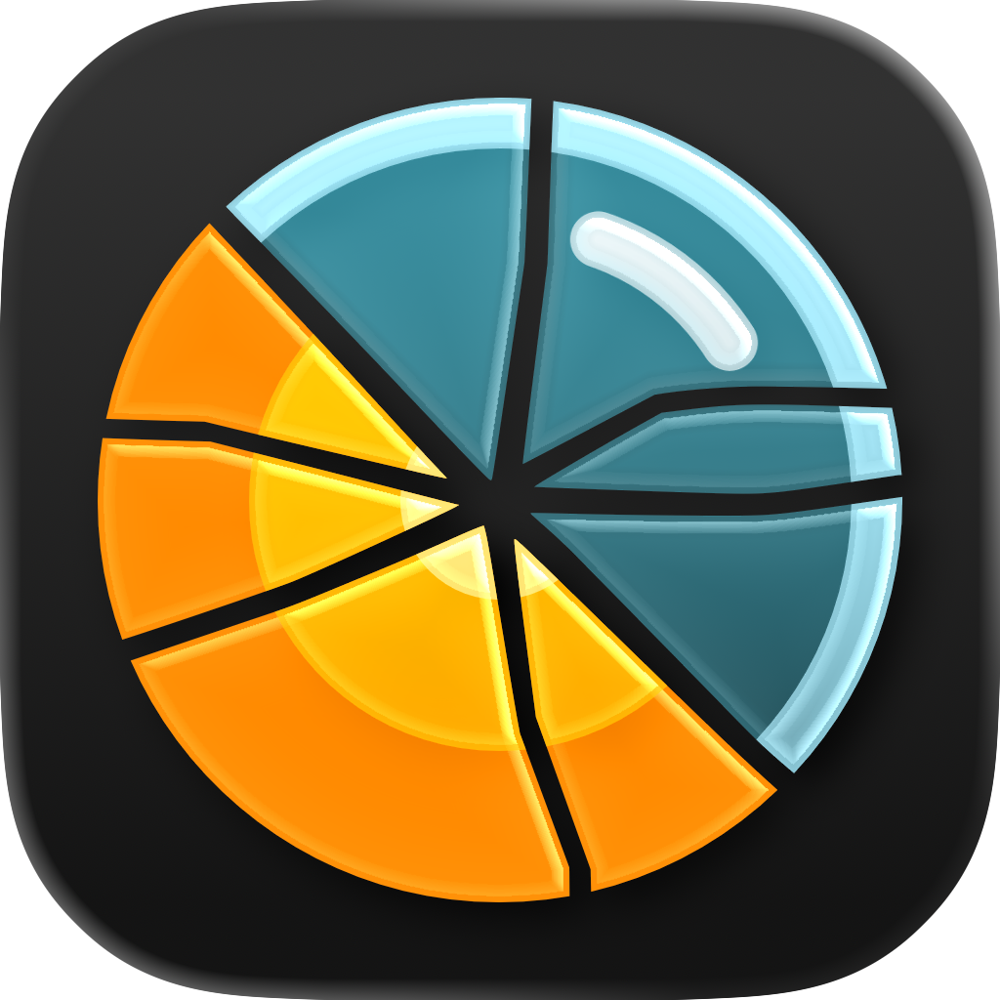
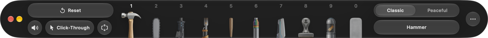

  

# Classic desktop destruction, reimagined for Mac.

A native macOS desktop toy inspired by Miroslav Němeček’s *Desktop Games / Desktop Destroyer*. Smash, scorch, saw, and paint over your windows, set ants and termites loose on your display, or take a calmer route with bubbles, confetti, and a beautiful Liquid Glass juggle ball. Clear it all in a click.

Obviously no telemetry, and no auto-updates (we have updates, of course, but checking for them is strictly manual. Why would a simple desktop toy even need an auto-update checker running in the background?). Just a sandboxed, zero-escalation, native Mac toy.

**[Download DeskSmash](https://github.com/ygtarslan/desksmash-releases/releases/download/desksmash-v1.1.3/DeskSmash-latest.dmg)**

`SHA-256 (DMG): eda67f3eabba4a5926c0eb0a66ee280544fe3b4c49ff8c6dd748e7aa43203834`

Requires macOS 15.0 or later. Supports Apple Silicon and Intel Macs. 
Made for macOS, with spatial audio, trackpad haptics, and ProMotion refresh rate support. 
*Version 1.1.3 adds recoil, muzzle flashes, tracers, shell casings, and firing spread to the Machine Gun. [Release notes](https://desksmash.ygtars.com/release-notes).*

---

**WHAT DOES IT DO?**

## Wreck your screen without touching your work.

DeskSmash draws an interactive overlay right over your desktop and open windows. Pick a tool, then click or drag to crack the screen, leave scorch marks, splash paint, or scatter confetti across whatever you have open.

Everything stays on the overlay. Your actual files and windows underneath are completely untouched. Wipe away a spot with the Polishing Cloth, reset the whole scene at once, or toggle Click-Through to get back to your open apps.

---

**WHY DESKSMASH EXISTS**

## An old desktop memory, rebuilt for my Mac.

Back when dial-up was still a thing and ADSL wasn’t even on the horizon, offline fun was gold. As a kid, I played *Desktop Games / Desktop Destroyer* on the computer at my parents’ pharmacy. That little Windows toy by Miroslav Němeček of Gemtree Software let you take a hammer, a chainsaw, termites, random stamps, or a flamethrower to your desktop. It was simple, offline fun, and it stuck with me.

Years later, I wanted that same feeling on my Mac. I couldn’t find an alternative that felt right, so I built DeskSmash. It is heavily inspired by the original, redesigned and reimagined as a modern, native macOS app.

The core idea is still simple, playful chaos over whatever is on your screen. DeskSmash brings back that familiar desktop destruction and tools that actually interact with each other, along with bubbles, confetti, tiny critters, and little games, all wrapped up with a Liquid Glass toolbar, spatial audio, and trackpad haptics.

---

**CHOOSE A MOOD**

## Sixteen tools. Two ways to play.

Each mode has ten tools, with four shared between them. Switch whenever you want the classic feel or a more peaceful session.

**Classic** 
Smash, saw, shoot, and scorch your desktop overlay. Critters react to weapon hits and flames. 
*Tools: Hammer, Chainsaw, Machine Gun, Flamethrower, Baseball Bat, Color Thrower, Phaser, Stamp, Critters, and Polishing Cloth.*

**Peaceful** 
Play with ribbons, confetti, bubbles, and little games. Critters stay completely unharmed in Peaceful mode. 
*Tools: Ribbon, Stamp, Biscuit, Confetti Gun, Critters, Juggle Ball, Color Thrower, Leafblower, Bubble Gun, and Polishing Cloth.*

---

**INSIDE THE DEFINITIVE EDITION**

## Every tool has its own feel.

**Machine Gun** 
Recoil, muzzle flashes, tracers, shell casings, and a crosshair that opens as you keep firing. Positional audio and rapid trackpad vibrations add to each shot.

**Bubble Gun** 
Tune the water-to-soap mix from fast, lively little bubbles to big floating ones.

**Leafblower** 
Sweep confetti and biscuit crumbs across your desktop with broad gusts of wind.

**Hammer & Baseball Bat** 
Leave branching hammer cracks or a wider fracture with a bat swing. Recoil, impact sounds, and trackpad haptics give each strike its weight.

**Flamethrower** 
Lay down a moving stream of flame and leave scorch marks across the screen. In Classic mode, just like in the original *Desktop Destroyer*, ants and termites char as they burn.

**Critters & Biscuit** 
Choose ants or termites and watch them do their thing. Drop biscuit crumbs for the ants to carry away, or let termites eat up settled confetti.

**Juggle Ball** 
Yep, basically a ball to juggle. But made of beautiful Liquid Glass.

**Polishing Cloth** 
You know what it is. Made with soft, nonabrasive material, the Polishing Cloth cleans any scorch mark, bullet hole, crack pattern, or paint splash safely and effectively.

---

**HARMLESS BY DESIGN**

## A mess on your screen. Your real desktop stays intact.

All the damage, paint, and debris live purely on the overlay. Wipe away a small patch or reset the whole scene whenever you’re ready to get back to work.

**No permissions needed. Duh.** 
DeskSmash runs strictly as a visual overlay. The app has zero awareness of your open windows or the content underneath.

**Click-Through** 
When you need to quickly interact with a window underneath, just activate Click-Through mode so mouse clicks bypass DeskSmash entirely. When you’re done, click the toolbar and get right back to relieving your stress.

**Auto-collapsible Toolbar** 
When you’re in a presentation or screen share (not sure why you’d be running DeskSmash during a presentation or screen share, but okay), you can enable auto-collapse so the toolbar shrinks into a small pill-shaped button whenever your pointer isn’t hovering over it.

---

## Ready for classic stress relief, reimagined?

Download DeskSmash and take it for a spin on your desktop.

Find DeskSmash on [itch.io](https://ygtars.itch.io/desksmash).

**[Download DeskSmash 1.1.3](https://github.com/ygtarslan/desksmash-releases/releases/download/desksmash-v1.1.3/DeskSmash-latest.dmg)**

[Support](mailto:ygtars@ygtars.com) · [Privacy Policy](https://desksmash.ygtars.com/privacy) · [Terms of Use](https://desksmash.ygtars.com/terms) 

© 2026 Yiğit Arslan.
